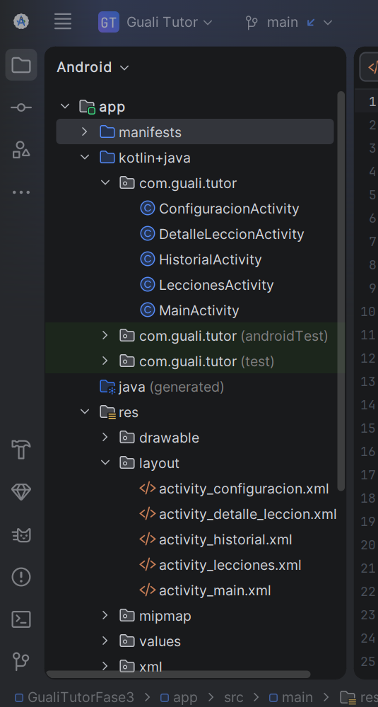
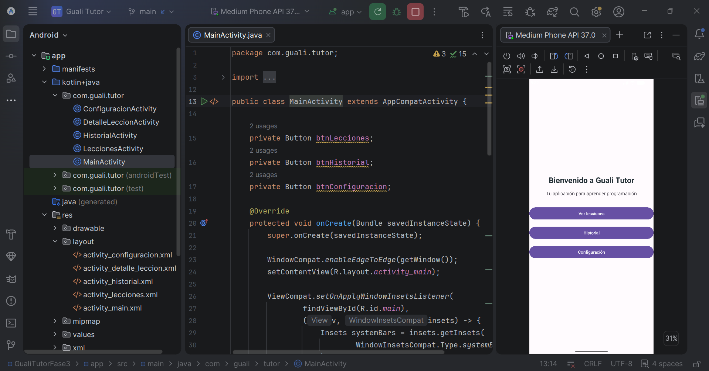
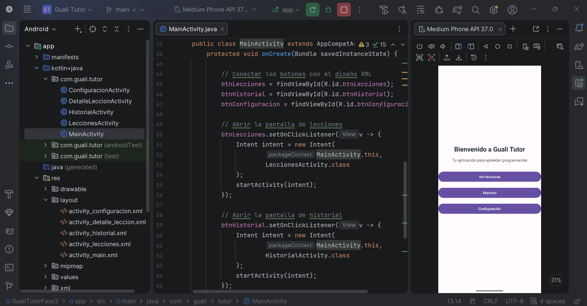
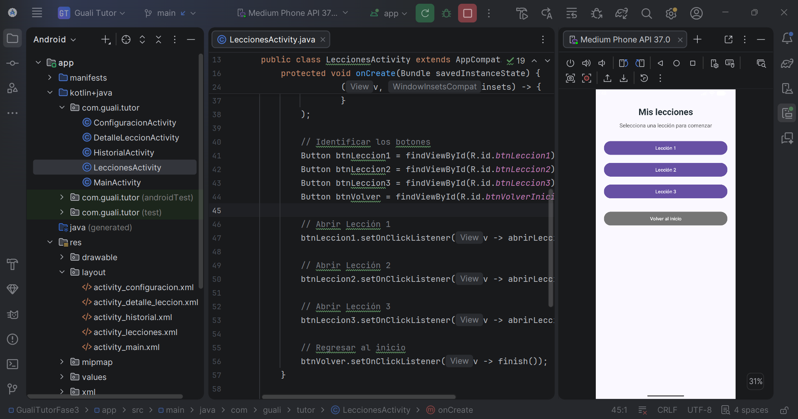
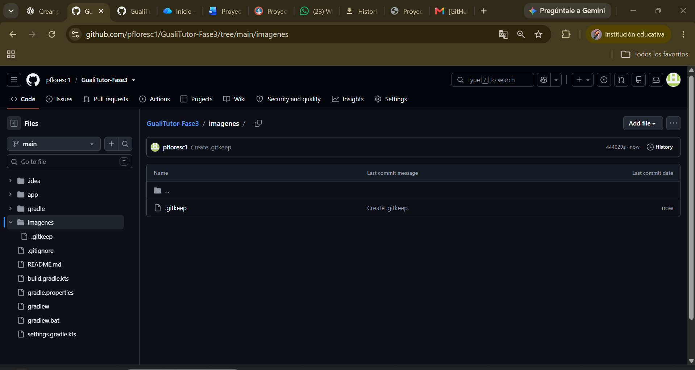

# Guali Tutor – Fase 3

## Tutorial de desarrollo de una aplicación móvil Android

### 1. Introducción

Guali Tutor es una aplicación móvil educativa desarrollada en Android Studio utilizando el lenguaje de programación Java.

Su propósito es facilitar el aprendizaje de conceptos básicos de programación mediante lecciones que incluyen explicaciones teóricas y ejemplos prácticos.

Este proyecto corresponde a la Fase 3 del curso de Programación II de la Universidad Mariano Gálvez de Guatemala.

### 2. Objetivo general

Desarrollar una interfaz gráfica móvil que permita a los estudiantes consultar lecciones de programación, registrar su progreso de aprendizaje y personalizar su experiencia.

### 3. Funcionalidades de la aplicación

- Pantalla principal con acceso a las diferentes secciones.
- Listado de tres lecciones de programación en Java.
- Visualización de explicaciones y ejemplos prácticos.
- Opción para marcar las lecciones como completadas.
- Historial del progreso de aprendizaje.
- Configuración del nombre del estudiante.
- Almacenamiento local mediante SharedPreferences.
- Navegación entre las diferentes pantallas.

### 4. Herramientas utilizadas

- Android Studio: entorno de desarrollo.
- Java: lenguaje de programación.
- XML: diseño de las interfaces gráficas.
- Android Emulator: ejecución y pruebas de la aplicación.
- SharedPreferences: almacenamiento local del progreso y la configuración.
- GitHub: publicación del proyecto y del tutorial.

### 5. Estructura de la aplicación

La aplicación está organizada en las siguientes pantallas:

1. MainActivity: menú principal.
2. LeccionesActivity: listado de lecciones.
3. DetalleLeccionActivity: contenido de cada lección.
4. HistorialActivity: progreso del estudiante.
5. ConfiguracionActivity: configuración del nombre del estudiante.

Cada pantalla utiliza un archivo XML para definir su diseño visual.

### 6. Prerrequisitos para desarrollar la aplicación

Para desarrollar y ejecutar Guali Tutor se necesitan las siguientes herramientas:

- Una computadora con Windows y espacio suficiente para Android Studio y el emulador.
- Android Studio instalado.
- Android SDK configurado desde Android Studio.
- Java como lenguaje de programación.
- Un emulador Android o un dispositivo físico compatible.
- Conexión a Internet para descargar las dependencias necesarias.

### 7. Instalación y configuración de Android Studio

#### Paso 1. Descargar Android Studio

Ingresar al sitio oficial:

https://developer.android.com/studio

Seleccionar la opción de descarga correspondiente al sistema operativo.

#### Paso 2. Instalar Android Studio

Ejecutar el instalador descargado y seguir las instrucciones del asistente.

Verificar que se instalen los componentes necesarios, incluyendo Android SDK.

#### Paso 3. Crear un nuevo proyecto

1. Abrir Android Studio.
2. Seleccionar New Project.
3. Elegir una plantilla basada en Views, como Empty Views Activity.
4. Asignar el nombre GualiTutorFase3.
5. Configurar el paquete com.guali.tutor.
6. Seleccionar Java como lenguaje.
7. Elegir el nivel mínimo de Android compatible.
8. Presionar Finish y esperar la sincronización de Gradle.

#### Paso 4. Configurar el emulador

1. Abrir Device Manager desde Android Studio.
2. Seleccionar Create Virtual Device.
3. Elegir un dispositivo de tipo Phone.
4. Seleccionar y descargar una imagen del sistema Android compatible.
5. Finalizar la configuración.
6. Iniciar el emulador.

#### Paso 5. Ejecutar el proyecto

1. Seleccionar el emulador configurado.
2. Presionar Run en Android Studio.
3. Esperar la compilación e instalación.
4. Verificar que la aplicación se abra correctamente.

### 8. Estructura del proyecto Android

La aplicación Guali Tutor se desarrolló en Android Studio utilizando Java para la lógica de programación y XML para el diseño de las interfaces gráficas.

El proyecto está organizado en diferentes clases y archivos que permiten separar las funcionalidades de la aplicación.

**Figura 1. Estructura del proyecto Guali Tutor en Android Studio**

La imagen muestra la organización del proyecto Android, incluyendo las clases Java encargadas de la lógica y navegación de la aplicación, así como los archivos XML utilizados para diseñar las diferentes interfaces gráficas.

#### 8.1. MainActivity.java

Es la clase principal de la aplicación.

Su función es mostrar el menú de inicio y permitir la navegación hacia las secciones de lecciones, historial y configuración.

**Figura 2. Código de MainActivity.java y pantalla principal de Guali Tutor.**

**Figura 3. Configuración de los botones y navegación entre pantallas.**

La imagen muestra cómo se conectan los botones de la pantalla principal con sus componentes XML mediante `findViewById()`. También se observa el uso de `setOnClickListener()` e `Intent` para abrir las pantallas de Lecciones e Historial.

#### 8.2. LeccionesActivity.java

Esta clase permite visualizar el listado de las tres lecciones disponibles.

El usuario puede seleccionar una lección para consultar su contenido educativo.

**Figura 4. Código de LeccionesActivity.java y listado de lecciones.**

La imagen muestra la implementación de los botones que permiten seleccionar las tres lecciones disponibles. También se observa la interfaz gráfica de la sección Mis lecciones ejecutándose en el emulador Android.

#### 8.3. DetalleLeccionActivity.java

Se encarga de mostrar la información correspondiente a la lección seleccionada.

Incluye:
- Título de la lección.
- Explicación del tema.
- Ejemplo práctico en Java.
- Botón para marcar la lección como completada.
- Botón para regresar al listado de lecciones.

El progreso se guarda localmente utilizando SharedPreferences.

#### 8.4. HistorialActivity.java

Permite consultar el progreso de aprendizaje del estudiante.

Muestra las lecciones completadas y pendientes, recuperando la información almacenada mediante SharedPreferences.

#### 8.5. ConfiguracionActivity.java

Permite personalizar la aplicación mediante el registro del nombre del estudiante.

La información se guarda localmente con SharedPreferences y se recupera cuando el usuario vuelve a ingresar a la pantalla.

#### 8.6. Archivos XML

Los archivos XML permiten definir la apariencia visual de las pantallas.

Los principales archivos son:

- activity_main.xml
- activity_lecciones.xml
- activity_detalle_leccion.xml
- activity_historial.xml
- activity_configuracion.xml

Cada archivo contiene los componentes gráficos utilizados en su pantalla correspondiente, como botones, textos y campos de entrada.

**Figura 5. Diseño de la pantalla principal de Guali Tutor**

En la siguiente captura se muestra el archivo `activity_main.xml` abierto en Android Studio, donde se define la estructura visual de la pantalla principal. A la derecha se observa la aplicación ejecutándose en el emulador Android, con los botones Ver lecciones, Historial y Configuración.

